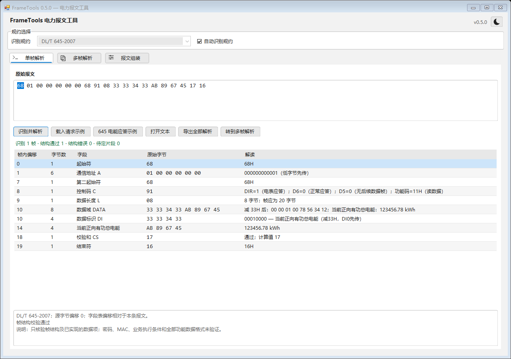
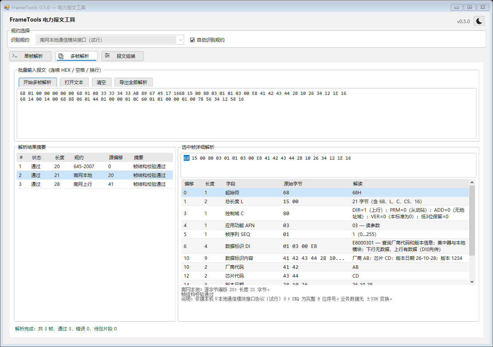
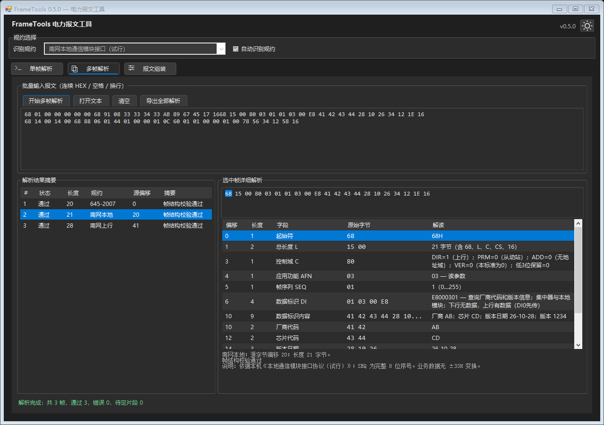
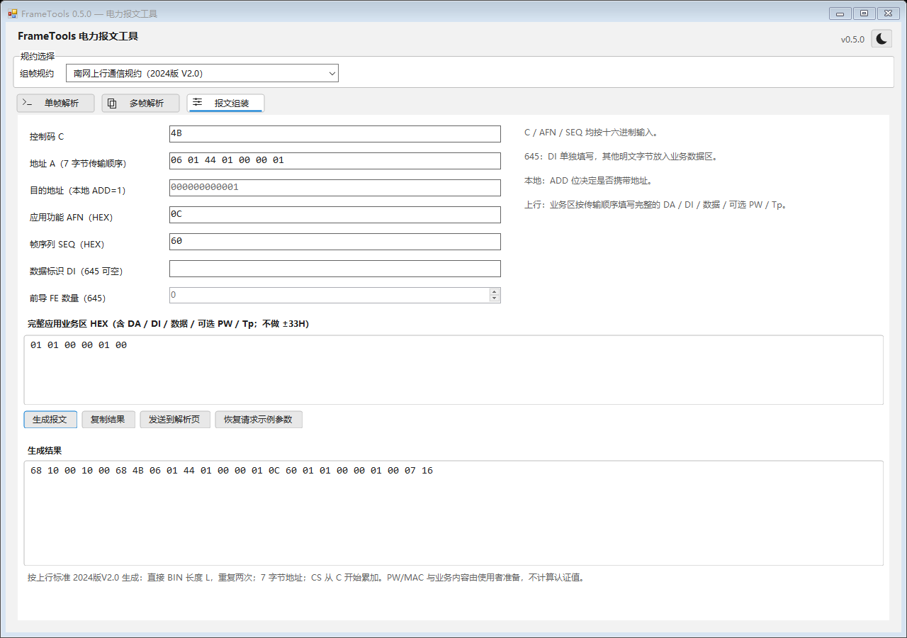

# FrameTools 电力报文工具

Windows 离线桌面工具，用于 DL/T 645-2007、南网本地通信模块接口和南网上行通信规约的报文解析及组装。当前版本为 **0.5.0，识别规约回显与常用业务字段解码**。

## 运行

构建产物：`artifacts/FrameTools.exe`。双击运行，无需 Python、Node.js 或网络连接。

- 目标环境：安装了 **.NET Framework 4.8** 的 Windows 10 / 11。
- EXE 为 AnyCPU 托管程序，不包含 .NET Framework 运行时。
- 不需要管理员权限。当前没有设备收发、自动更新或网络上传功能。

## 已实现

| 功能 | 645 | 南网本地 | 南网上行 |
| --- | --- | --- | --- |
| 自动识别、连续多帧解析 | 已实现 | 已实现 | 已实现 |
| 偏移与逐条字段定位 | 已实现 | 已实现 | 已实现 |
| 起止符、长度、累加和诊断 | 已实现 | 已实现 | 已实现 |
| 参数组帧及自动计算长度、CS | 已实现 | 已实现 | 已实现 |
| 地址、控制字段解析 | 6 字节 BCD / AA | 可选 12 字节源、目的地址 | 7 字节地址域 |
| 应用字段 | 控制位中文含义、±33H、DI 名称、ERR 位原因 | 控制位、AFN、8 位 SEQ、108 项 DI 名称 | 控制位、AFN、SEQ、Tp；已知明文首 DA / DI |
| 业务数值 | 常用电能、电压、电流、功率、功率因数、频率、温度、时间等 | 确认/否认、模块版本/能力、节点、时间、任务状态等 | 已知首信息体的常用电参、通信参数、登录/心跳、确认结果等 |

同时提供无空格 / 有空格 HEX 自动整形、内置请求示例、645 电能应答示例、文本报文导入和 UTF-8 全部解析报告导出。

“解读”列同时显示控制位含义、DI 名称和已支持的数据值 / 单位；复杂字段进一步展开为子行，并保留原始字节与偏移。具体支持项、标准依据及边界见 [字段解码范围](docs/decoding.md)。

**“帧结构校验通过”只表示已实现的字节结构检查通过，不代表业务字段全部合法、认证成功或真实设备会接受该命令。** 未知 DI 保留原始字节；上行 PW/MAC 不计算、不验证、不解密，也不猜测多信息体边界。

## 使用

1. 软件打开后是空白工作区，不加载样例、不识别报文。单条报文放入 **“单帧解析”**，连续日志放入 **“多帧解析”**；支持有空格、无空格、无换行及混合规约。
2. 点击 **“识别并解析”** / **“开始多帧解析”** 或按 `Ctrl+Enter` 才开始处理。“自动识别规约”只控制如何匹配规约，不会触发定时或输入即解析。
3. 单帧页上方只显示原始输入，下方为字段和诊断；点击字段可定位原始报文中的对应字节，兼容紧凑、分隔及 `0x` 前缀输入。多帧页上方输入，下方左侧列出每条帧 / 片段的状态、长度、规约及源偏移，右侧显示选中帧的整形 HEX、字段和诊断。原始输入保持不变。
4. 单帧页检测到多条报文或多个片段时，提示使用 **“转到多帧解析”**；点击后只转移原始输入，再点击开始解析。
5. 在 **“报文组装”** 页填写参数，生成结果后可复制或发送到单帧页检查。`Ctrl+Enter` 在该页执行组帧。

末尾半帧或半个字节会保留，追加完整后再次点击识别。错误帧显示诊断，未识别数据也会显示为片段，不会静默删除。若多个规约均满足结构和校验，工具提示歧义；取消“自动识别规约”后，可以使用顶部下拉框手动指定，再点击识别。

解析页勾选自动识别时，顶部下拉框不可选，标签为“识别规约”：单帧识别后显示结果，多帧随当前选中帧更新；尚未识别、未知或有歧义时为空。回显不会清除解析结果或改动组帧参数。关闭自动后恢复先前手动规约；切换到组帧页后恢复其可用的“组帧规约”，自动识别开关隐藏。载入示例、打开文本和把生成结果送到解析页都只填充输入，不会隐式识别。

例如在“多帧解析”中粘贴 [三协议连续串](examples/mixed-continuous.hex) 后点击开始解析，会分成 645、本地、上行三条报文。它们之间没有空格或换行也可以解析。

可在单帧页打开 [本地模块版本应答](examples/local-version-response.hex)，查看厂商 `AB`、芯片 `CD`、版本日期 `26-10-28` 和版本 `1234`；打开 [上行电能应答](examples/uplink-energy-response.hex)，查看 `123456.78 kWh`。两者均为构造样例。

输入范围是 HEX 报文字节；设备日志中的 `TX` / `RX` 标签、时间戳或说明文字需要先移除。程序不会通过删除任意非 HEX 字符来猜测报文内容。

组帧时的输入约定：

- **645**：地址按高字节在前输入，如 `000000000001`；DI 按 `DI3…DI0` 输入，如 `00010000`；业务数据输入减 33H 后的明文字节。程序自动调整地址、DI 字节序并加 33H。读通信地址时用 C=`13` 并清空 DI。
- **南网本地**：C 的 D5 为 ADD，置 1 时填写源、目的地址，均按高字节在前输入；DI 如 `E8000301`。SEQ 为完整 8 位数值，输入格式仍为 HEX，例如 `FF`。
- **南网上行**：地址按实际传输顺序填写 `A1(3) + A2(3) + A3(1)`；业务区输入完整的 DA、DI、数据及可选 PW、Tp。程序不转换业务区字节序，不做 ±33H。
- C、AFN、SEQ 均按 1 字节十六进制输入。

输入内容变更后清除过期结果，需要再次点击识别；组帧参数变更后需要重新生成。程序不会自动修正导入报文的校验和。

## 界面

按用户提供的桌面报文工具截图调整：紧凑工具栏、轻微圆角、细边框、图标页签和交替行底色。默认浅色，点击右上角月亮 / 太阳图标可即时切换暗色 / 浅色，输入、解析结果和当前选中帧保持不变。主题只作用于本次运行，重新打开恢复默认浅色。

各页多行文本框只在内容超出可见范围时显示滚动条；清空、缩短文本或放大编辑区后按需隐藏。单帧底部说明框也遵循此规则，正常内容不显示常驻滚动条。

多帧页参考 [South_Network_Protocol_Analysis_Tool](https://github.com/Liruitao1993/South_Network_Protocol_Analysis_Tool/tree/main) 的摘要 / 详情分栏方式，分隔条可以拖动。较小窗口下表格提供滚动；组帧页保留纵向滚动和输入空间。

以下是本程序使用构造样例的离屏渲染预览：









当前视觉核对范围见 [验证记录](docs/verification.md)。[启动和界面记录](docs/startup-and-ui.md) 保留的是 v0.3.0 历史测量，不代表当前版本的启动耗时。

## 构建与测试

在 Windows PowerShell 中执行：

```powershell
.\Build.ps1 -Test
```

脚本使用本机 .NET Framework C# 编译器，不下载 NuGet 包，不安装全局工具。产物输出到 `artifacts/`；`-Test` 会临时生成 `FrameTools.Tests.exe`，运行软件只需要 `FrameTools.exe`，交付目录仅保留主程序。也可以通过 Visual Studio 打开 `src/FrameTools/FrameTools.csproj`，需要相应的 .NET Framework 4.8 开发组件。

如 PowerShell 的当前执行策略阻止脚本，可以仅为本次进程执行：

```powershell
powershell.exe -NoProfile -ExecutionPolicy Bypass -File .\Build.ps1 -Test
```

验证情况见 [验证记录](docs/verification.md)，本次审查见 [0.5.0 Code Review 记录](docs/code-review-v0.5.0.md)。

## 标准与设计

- [功能与技术设计](docs/design.md)：标准版本、功能分期、帧结构、实现边界和验收条件。
- [GitHub 开源项目调研](docs/open-source-research.md)：接近需求的项目、许可证及复用建议。
- [标准文件清单](specifications/README.md)：本机原始文件位置和使用范围。
- [构造报文示例](examples/)：用于学习和测试，不是真实设备抓包。

## Git

本地仓库使用 `main` 分支；源代码、构建脚本、测试、示例和设计文档纳入版本管理。原始标准、临时提取内容及构建产物保留在本机，通过 `.gitignore` 排除。

项目仓库：[Bain-Lee/electronic-frame-tool](https://github.com/Bain-Lee/electronic-frame-tool)。主分支为 `main`，版本由 Git 标签定位，保留现有提交历史。当前没有引入调研项目的代码。

```powershell
git clone git@github.com:Bain-Lee/electronic-frame-tool.git
cd electronic-frame-tool
.\Build.ps1 -Test
```

Windows EXE 输出到本机 `artifacts/FrameTools.exe`，不作为源码文件提交。原始标准和临时提取文本也不会上传。后续可从 `main` 新建功能分支，验证后再合并；无需重置历史或强制推送。

## 后续范围

首要工作是使用真实设备报文补齐业务数据项和多信息体解析；其次是报文模板、带时间戳 / 标签的日志提取、嵌套 645 和报文对比。串口 / TCP 收发、MQTT 承载和安全认证对接分别安排后续版本，详见设计文档。
