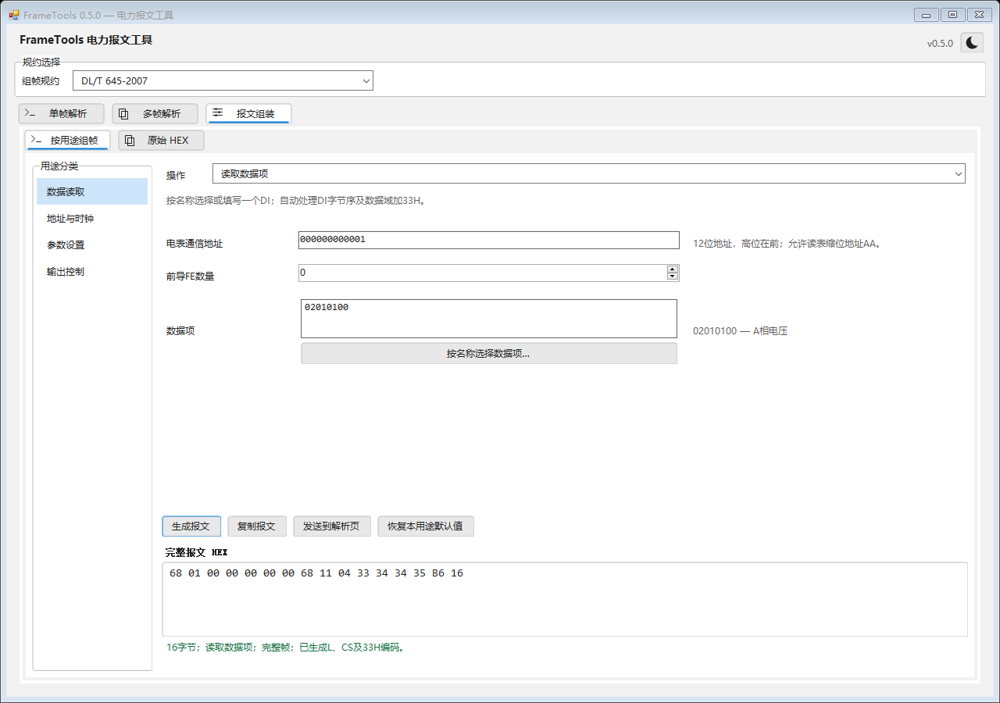
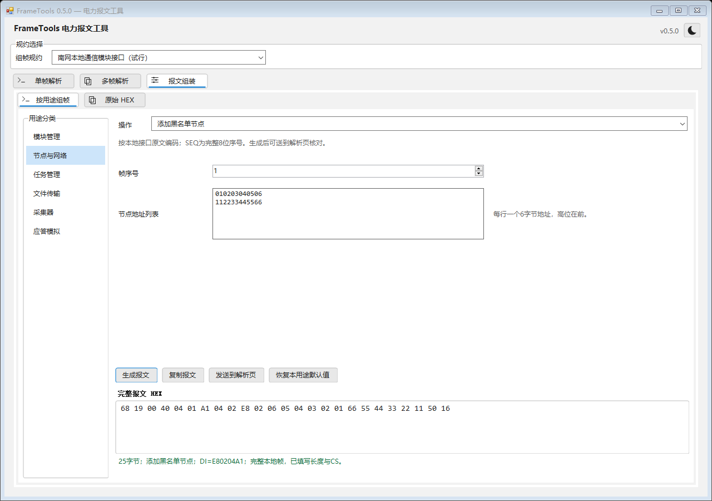
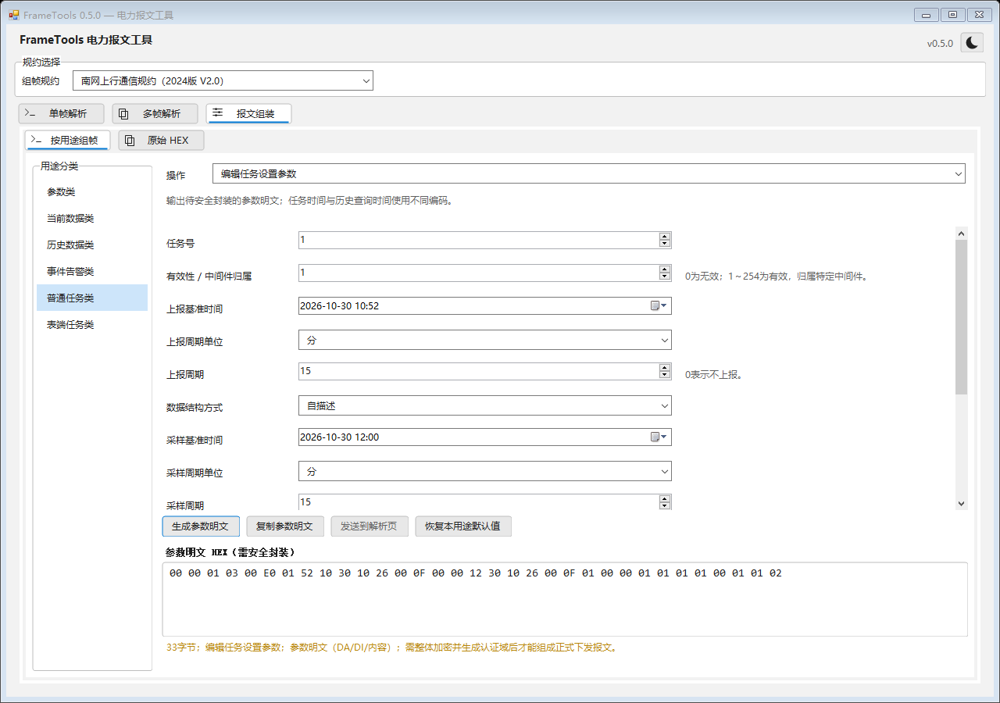

# 按用途可视化组帧

进入 **报文组装 → 按用途组帧**，在顶部选择规约，再选择左侧分类和右侧操作。填写参数后点击生成，也可按 `Ctrl+Enter`。当前提供645的7个用途、本地通信的42个用途、上行的18个用途，共67个入口；不表示规约中所有业务均已实现。

日期使用日历控件，时间可直接选择对应的时、分、秒；645单独设置日期时显示日期和星期，单独设置时间时只显示时间。周期、单位、模式及开关使用数值框或下拉框；类型筛选使用两列表格。不可用的字段及其整行会移除，同一用途切回原模式时保留本次填写的值。更换上行设置内容时，其值重置为对应默认值。切换用途、切换规约或恢复默认值会重新填写该用途的默认参数。

结果可复制。完整帧可送到单帧解析页，转移后需要再点击解析；参数变更会清除旧结果。原有手工入口保留在 **原始 HEX** 子页，两个入口的内容彼此独立。

## DL/T 645-2007

| 分类 | 用途 | 自动填写的内容 |
| --- | --- | --- |
| 数据读取 | 读取一个数据项 | C=11、DI传输顺序、数据域+33H |
| 地址与时钟 | 读取通信地址 | C=13、全AA地址、空数据区 |
| 地址与时钟 | 设置通信地址 | C=15、全AA地址、新地址反序 |
| 地址与时钟 | 广播校时 | C=08、全99地址、秒分时日月年 |
| 参数设置 | 设置日期及星期 | C=14、DI=04000101、自动计算星期 |
| 参数设置 | 设置时间 | C=14、DI=04000102、秒分时 |
| 输出控制 | 多功能端子输出 | C=1D、秒脉冲/需量周期/时段投切选择 |

设置日期和时间需输入02/04级权限、3字节密码、4字节操作者代码。密码和操作者代码按实际传输顺序输入HEX；密码框遮蔽显示，程序不写入配置文件。只生成明文密码方式，不生成98/99密文或MAC。生成完整写帧也不表示已完成电表的编程键、密码权限或执行条件校验。

数据项选择器提供常用项目，并支持手工填写其他8位DI；645每次读取一个DI。各用途沿用既有645帧编码器填写长度和CS。

## 南网本地通信模块接口

| 分类 | DI | 用途 |
| --- | --- | --- |
| 模块管理 | E8000301 | 查询厂商与版本 |
| 模块管理 | E8000302 | 查询模块运行模式 |
| 模块管理 | E8000303 | 查询主节点地址 |
| 模块管理 | E8020401 | 设置主节点地址 |
| 模块管理 | E8020101 | 复位硬件 |
| 模块管理 | E8020102 | 初始化档案 |
| 模块管理 | E8020103 | 初始化任务 |
| 模块管理 | E80204A3 | 设置CCO时钟 |
| 节点与网络 | E8000305 | 查询从节点数量 |
| 节点与网络 | E8030306 | 查询从节点列表 |
| 节点与网络 | E8020402 / E8020403 | 添加 / 删除从节点 |
| 节点与网络 | E8030308 | 查询从节点父节点 |
| 节点与网络 | E803030C / E803030D | 指定 / 批量查询节点相位 |
| 节点与网络 | E803030E | 查询台区识别结果 |
| 节点与网络 | E8030315 | 批量查询模块特征 |
| 节点与网络 | E8020404 | 设置节点事件上报 |
| 节点与网络 | E8020405 / E8020406 | 激活 / 终止节点主动注册 |
| 节点与网络 | E80204A0 / E80303A0 | 设置 / 查询即插即用开关 |
| 节点与网络 | E80204A1 / E80204A2 / E80303A1 | 添加 / 删除 / 查询黑名单节点 |
| 任务管理 | E8020201 | 添加单节点任务 |
| 任务管理 | E8020207 | 添加多播任务 |
| 任务管理 | E8020202 | 删除任务 |
| 任务管理 | E8000203 / E8030204 / E8030205 | 查询未完成任务数量 / 列表 / 详情 |
| 任务管理 | E8000206 | 查询剩余可分配任务数 |
| 任务管理 | E800030B | 查询建议超时时间 |
| 任务管理 | E8020208 / E8020209 | 启动 / 暂停任务 |
| 文件传输 | E8020701 / E8020702 | 启动文件传输 / 传输文件段 |
| 文件传输 | E8000703 / E8000704 | 查询文件信息 / 处理进度 |
| 采集器 | EA002301 | 查询采集器厂商与版本 |
| 应答模拟 | E8010001 / E8010002 | 确认 / 否认应答 |

节点地址每行一个，按高字节在前输入。程序生成节点数量、地址传输顺序及分页参数。任务ID范围为0～EFFF；SEQ为0～255的完整8位数值，在用途模式中按十进制填写。

单节点任务自动使用ADD=1并显示源、目的地址。多播任务可选择指定节点或全部节点；全部节点编码为FFFF并省略节点列表。组合多帧时每行填写一条内层HEX，程序生成报文条数、每条2字节长度及外层1/2字节内容长度；内层报文保持原字节，不修改或认证其内容。

文件用途仅编辑单次请求，不提供文件选择、自动分段或收发流程。文件总校验、文件段校验均由使用者按传输顺序提供2字节HEX，程序没有推测其算法。原文存在歧义的邻居主节点、文件失败节点04/05等用途不进入可视化选项。

## 南网上行通信规约

| 分类 | 用途 | 输出 |
| --- | --- | --- |
| 参数类 | 读取参数；编辑心跳、终端时间、APN、TCP/UDP、压缩方式 | 读取为完整帧；设置为参数明文 |
| 当前数据类 | 读取当前数据 | AFN=0C完整请求 |
| 历史数据类 | 按时间范围和密度读取 | AFN=0D完整请求 |
| 事件告警类 | 事件记录；告警数据 | AFN=0E / 13分别生成 |
| 普通任务类 | 读取/编辑任务参数、读取数量、读取有效性位图、读取/编辑存储深度 | 读取为完整帧；设置为参数明文 |
| 表端任务类 | 读取/编辑任务参数、读取数量、读取有效性位图、读取/编辑存储深度 | 读取为完整帧；设置为参数明文 |

上行数据项选择器读取内嵌XML的名称，按用途对应的AFN筛选；可输入名称或DI搜索，最多显示200项，勾选结果在切换筛选时保留。事件/告警即使内容结构暂为raw，也可按已明确的DI构造读取请求；原文歧义项不进入选择列表。

测量点可写 `1,3,5-6`，0代表终端，范围为0～2032，`全部`代表除终端外的全部测量点。程序按DA组和DI生成读取组合。历史密度1～5选择当前数据定义，6～7选择历史数据定义；更换密度后需核对并重新选择DI，不会自动替换用户已填写的数据项。扩展DI可使用原始HEX入口。

查询时间精确到分钟，采用四位年份的正序BCD：例如2026年10月30日10:52为 `20 26 10 30 10 52`，年份范围1970～2099。时间区间开始包含、结束不包含。历史默认查询前一日，事件和告警默认查询最近一天；事件另有“最近10条”，其起止时间全为FF，选择后收起日期输入。告警没有复用这一快捷方式。

任务号为1～254；数量00、有效性位图FF及存储深度使用独立用途。普通任务支持0～4种结构方式，方式2/4用电表类型和用户类型替换测量点输入。有效性为0或1～FE；表端任务有效性为0/1，只支持结构方式0/1，并额外显示终端查询基准时间及周期。任务时间按分钟到年份反序传输，与历史查询时间不同。程序约束编码后的信息点组数n与DI数m满足n×m＜256。

**上行设置输出的是DA、DI和内容组成的参数明文。** 规约要求将该部分整体加密并填写PW/MAC；本版没有认证模块接口，未伪造完整设置帧。界面明确标注“参数明文”，复制按钮使用同名提示，并禁止将其当成完整帧送到解析页。读取请求未添加可选PW/Tp；实际系统的安全策略需另行对接。

## XML和代码的分工

XML继续提供数据项名称、AFN、方向、状态和已明确的解码结构，现在也参与数据项搜索与历史密度筛选。各用途的控件和编码规则由 `PurposeComposer.cs`、`PurposeComposerView.cs` 实现，帧外壳继续使用既有 `FrameCodec`。新增一条XML并不会自动获得可写表单或安全认证能力。

本功能只生成、复制及转移报文，没有串口、TCP或MQTT发送。验证使用本机标准构造向量及自身WinForms窗口，详情见 [验证记录](verification.md)。
