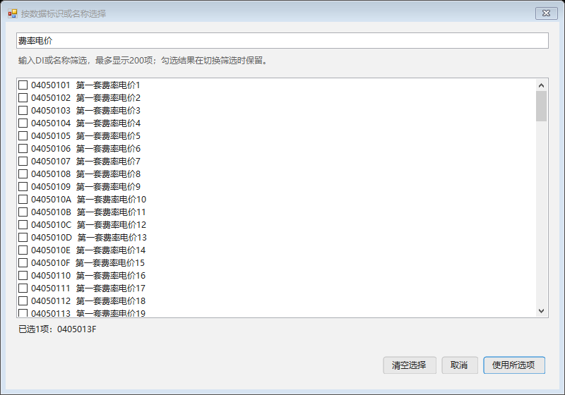
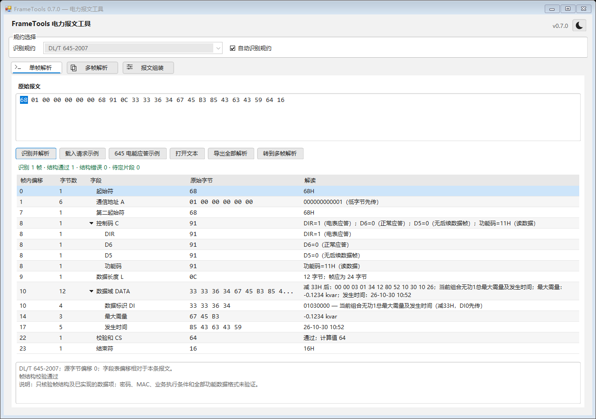

# FrameTools 0.7.0

本版补齐DLT645.xml，并将645的DI名称、数据项检索和明确字段解码接入与CSG相同的字典维护路径。以本机 `specifications/` 技术规范为依据，参考Assistent配置只用于比较。

主要变化：

- 645电能/需量实际费率块、最大需量及发生时间、明确冻结子项、参数、ASCII、日期/结算日和附录C位域从XML解释。
- 数据项选择器支持按标准DI/名称检索，每次最多显示200项，保留645单选；不再只有14项固定清单。
- 纠正结算日范围误套、参数编号、跨页读写权限、符号、单位及状态字误按BCD等问题；未重组的后续帧保留原始值。
- 新增可复现生成器、逐表依据、参考差异和四项原文矛盾说明；复杂结构继续保留raw。

范围与维护命令见 [645规范对齐](dlt645-alignment.md)，变更审查见 [Code Review](code-review-v0.7.0.md)。

## 应用与版本

窗口标题、界面版本和解析报告为0.7.0；程序集、文件版本、产品版本与应用清单为0.7.0.0。日常入口为 `artifacts/FrameTools.exe`，保留带版本副本 `artifacts/FrameTools-v0.7.0.exe`；历史0.6.0副本不覆盖。

EXE内嵌DLT645、CSG13、CSG16三份XML，运行时不依赖外部XML、Python、Assistent或原始规范。修改XML后需要重新构建。源码通过Git标签 `v0.7.0` 定位，EXE与标准原件不提交到源码仓库。

## 验证与示例

完整回归209项通过、0项失败，项目Release构建成功。检查依据和限制见 [验证记录](verification.md)。在单帧页打开 [组合无功需量应答](../examples/645-demand-response.hex)，点击识别，可查看 `-0.1234 kvar` 和发生时间 `26-10-30 10:52`。这是构造样例，不是真实设备抓包。

以上为本程序自身离屏预览。未完成真实设备、通信通道、认证模块、全部复合业务或多DPI验收。
