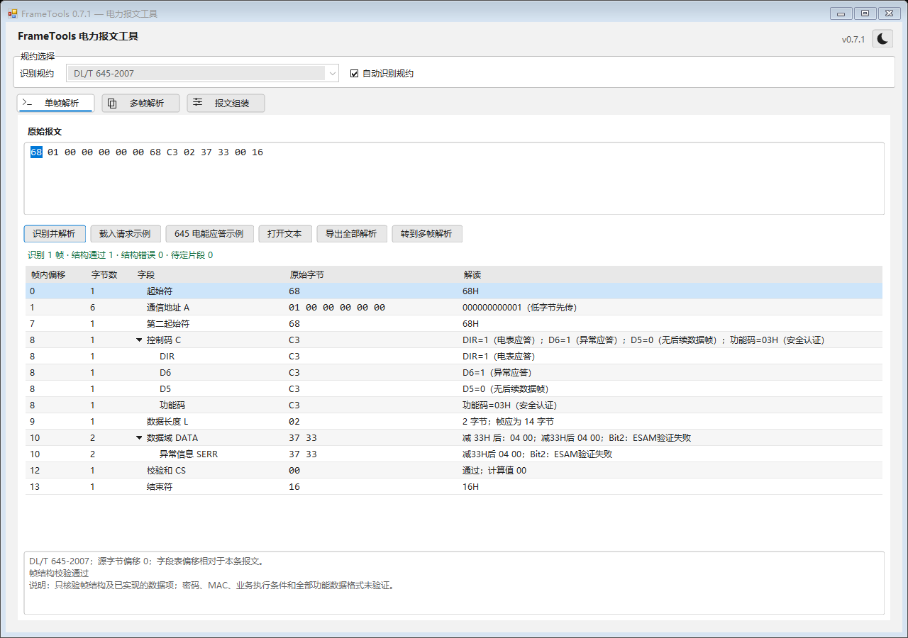
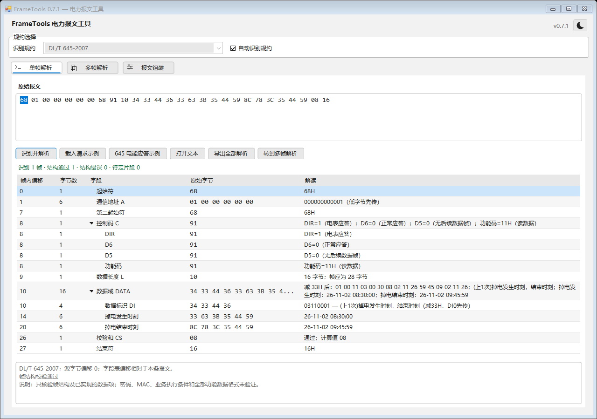

# FrameTools 0.7.1

本版修复标准复查发现的七类问题：645的03H/1CH/1DH自动识别、SERR两字节及位含义、安全专用DI命令归类、上行组合电能符号、浮动系数方向、四个集合项误按单值消费，以及掉电记录的两个时间字段。

具体触发条件、标准章节、修正与未验证范围见 [标准对应审查](standards-review-2026-11-02.md)。本版没有新增认证算法、通信通道或会话重组；集合布局未明确的内容保留raw。

完整回归218项通过、0项失败；项目Release构建成功。窗口、报告和版本标签为0.7.1，程序集、文件/产品版本及清单为0.7.1.0。构建物目录仅保留 `artifacts/FrameTools.exe`，不生成带版本副本；历史源码通过Git标签定位。

三份XML内嵌，修改后需要重新构建，运行时不依赖Python、规范原件或外部XML。验证记录见 [verification.md](verification.md)。

可在单帧页打开 [安全异常应答](../examples/645-security-error.hex) 或 [掉电双时标应答](../examples/645-power-loss-response.hex)，点击识别核对。两者均为构造样例，不是真实设备抓包。以下为最终EXE的自身离屏预览。

