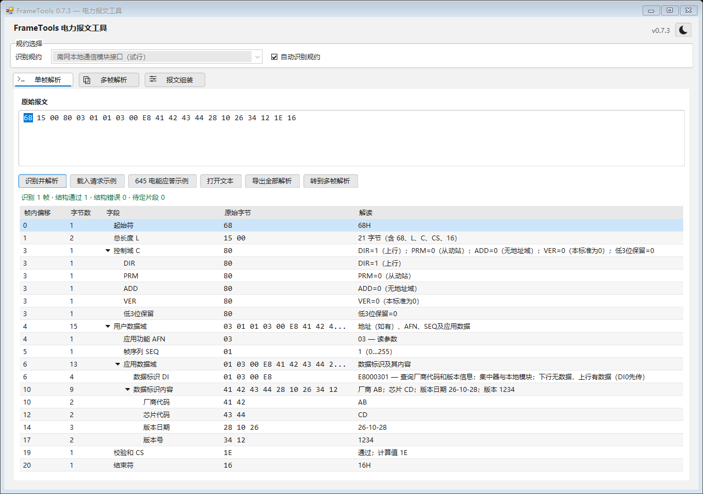
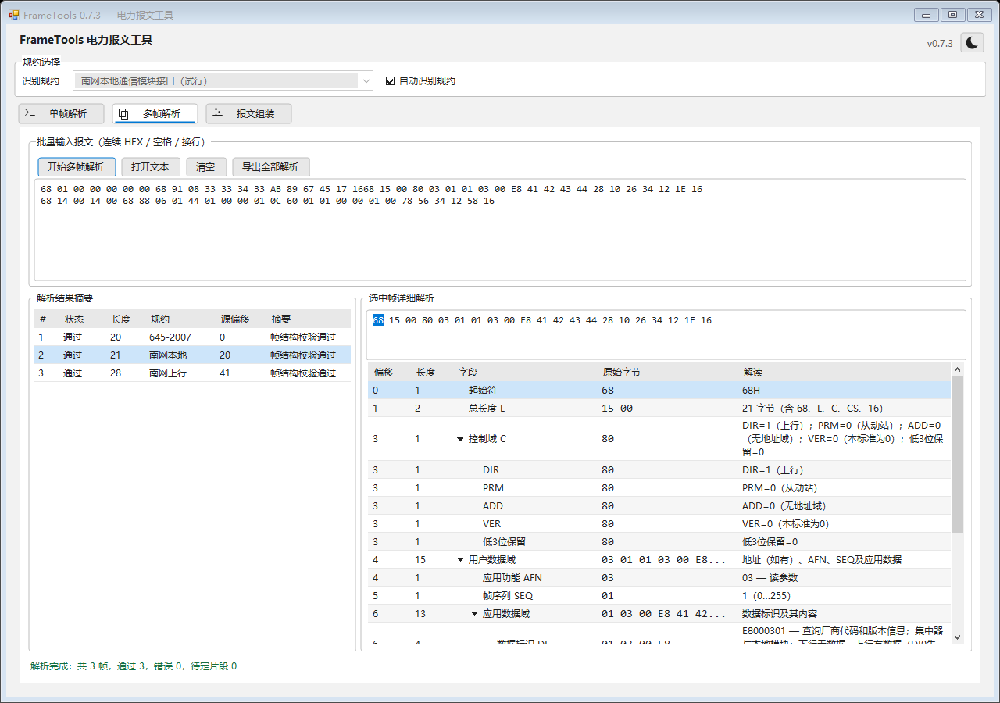

# FrameTools 0.7.3

修正拖动列宽时持续重算全表行高造成的卡顿：表头和整列仍实时跟随鼠标，拖动期间保持现有行高，松开或捕获丢失后统一恢复自动换行。长文本行在拖动、滚动后保持完整显示。

删除单帧及多帧详情底部重复显示“规约名称；帧结构校验通过”的信息框，腾出空间用于字段表。规约仍显示在顶部，校验结果可从状态查看，具体CS值保留在字段表和完整导出报告中。

完整回归222项通过、0项失败，其中窗口41项。离屏基准中，24行长解读样例的单次移动处理中位耗时由45.875毫秒降至0.430毫秒；松开后仍有一次完整行高适配开销。测量条件及长表格结果见 [验证记录](verification.md)。

应用版本为0.7.3，程序集、文件/产品版本及清单为0.7.3.0。构建物目录仅保留最新 `artifacts/FrameTools.exe`，源码标签为 `v0.7.3`。

