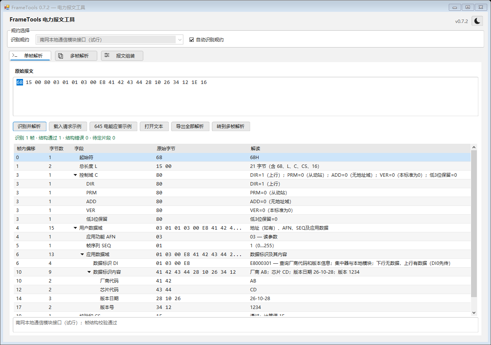
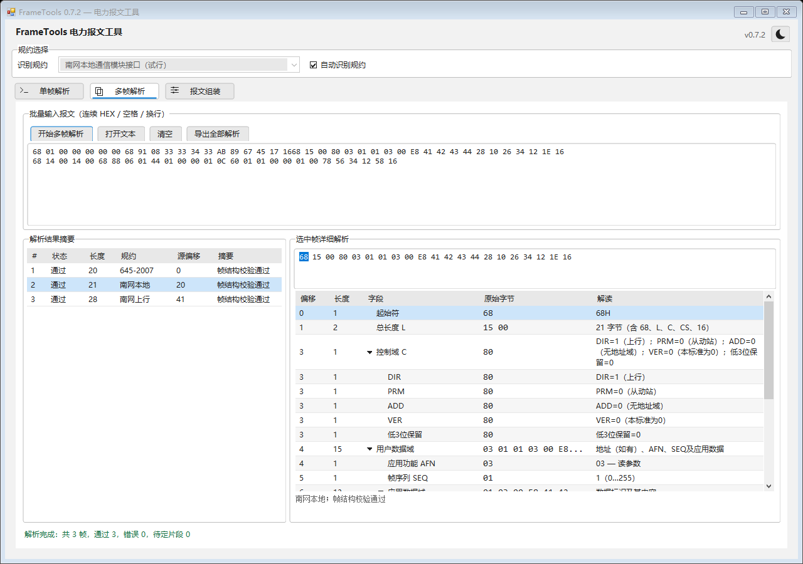

# FrameTools 0.7.2

解析界面拖动表头边界时，整列和相邻列实时跟随鼠标调整，支持放宽和缩窄。单帧字段、多帧摘要和多帧详情使用同一交互；折叠字段、切换帧后保留列宽。

单帧及多帧详情的底部信息区从90/85像素缩小为40像素，只显示规约名称和帧结构校验结果。正常帧显示通过；失败帧保留具体校验错误；不完整、未识别、规约歧义及格式错误明确显示未校验。源偏移、解析说明等完整信息保留在导出报告中。

完整回归221项通过、0项失败，其中窗口回归40项；新增三组用例先在旧版复现失败。已核对亮暗主题、拖动中、校验失败与最小窗口的自身离屏预览。验证详情见 [验证记录](../verification/history.md)。本版未改动协议解析与XML定义。

应用版本为0.7.2，程序集、文件/产品版本及清单为0.7.2.0。构建物目录仅保留 `artifacts/FrameTools.exe`，Git标签为 `v0.7.2`。

